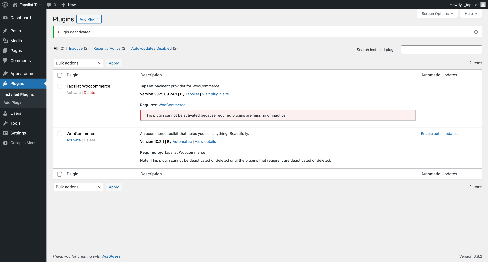
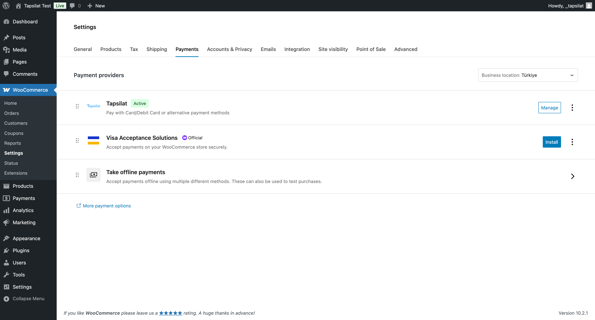
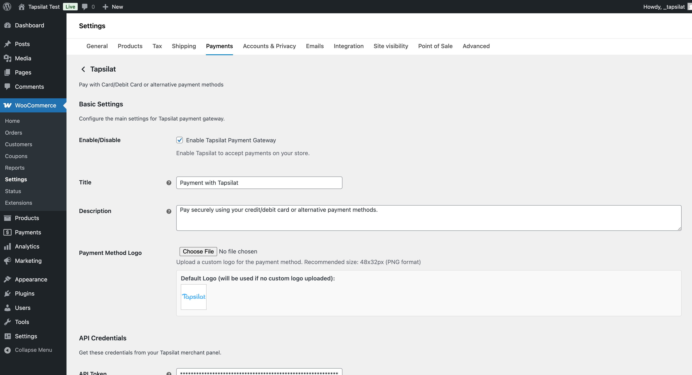
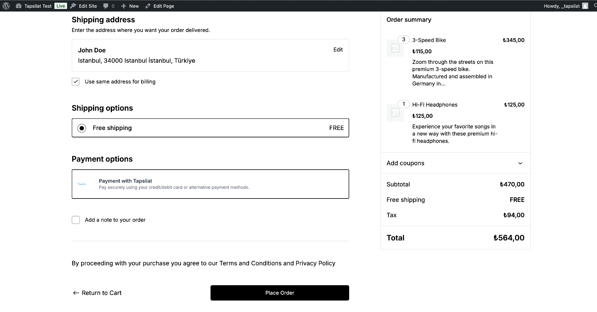
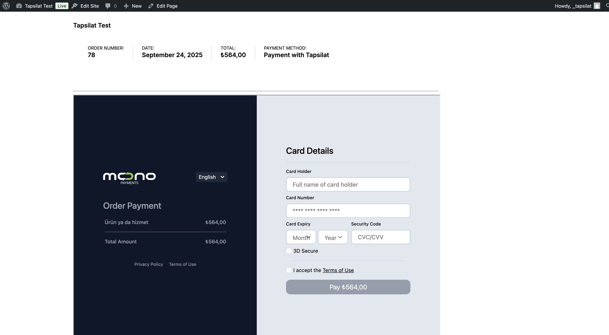

# Tapsilat WooCommerce Plugin

Modern payment gateway plugin for WooCommerce that integrates with Tapsilat payment system.

[download latest](https://github.com/tapsilat/tapsilat-woocommerce/releases/latest/download/tapsilat-woocommerce.zip)

**Version:** 2025.09.25.1

## Features

- Secure payment processing via Tapsilat
- Support for WooCommerce Blocks (Gutenberg checkout)
- Multiple payment form display modes (iframe, redirect, popup)
- Automatic order status management with configurable cron job
- Webhook support for real-time payment updates
- Compatible with WooCommerce HPOS (High-Performance Order Storage)
- 3D Secure authentication support
- Multi-currency support (TRY, USD, EUR)
- Customizable payment form design and branding
- Advanced order status monitoring and automatic updates
- Custom logo support for payment method
- Flexible API environment configuration (Production/Custom)
- Full support for all Tapsilat API endpoints (Organization, System, Submerchant, Subscriptions) via integrated helper classes
- Advanced Checkout capabilities including partial/full refunds, manual callbacks, split payments and OIP
## Installation

1. Upload the plugin files to `/wp-content/plugins/tapsilat-woocommerce` directory
2. Activate the plugin through the WordPress admin panel
3. Go to WooCommerce Settings > Payments > Tapsilat
4. Configure your Tapsilat API credentials
5. Enable the payment method

## Configuration

### Required Settings

- **Token**: Your Tapsilat API token
- **API Environment**: Choose between Production or Custom
- **Currency**: Select your preferred currency (TRY, USD, EUR)

### Advanced Configuration Options

- **3D Secure**: Enable/disable 3D Secure authentication for enhanced security
- **Payment Form Display**: Choose between iframe (embedded), redirect, or popup modes  
- **Order Status Check Frequency**: Configure automatic cron job interval (5, 10, 15, or 30 minutes)
- **Design Customization**: Customize colors for input fields, labels, buttons, and panels
- **Custom Logo**: Upload custom logos for both payment method and checkout page
- **Custom Metadata**: Add additional data to be sent with orders (JSON format)

### How to get API Key?

You can get API Key from [Tapsilat](https://panel.tapsilat.com) website.

### Payment Callbacks

Every order the plugin creates tells Tapsilat where to post its payment callbacks and where the checkout's "return to store" links lead, so no URL setup is needed:

- Callbacks: `https://yoursite.com/wp-json/tapsilat/v1/webhook/payment-callback?order_id=…&key=…`
- Customer return: `https://yoursite.com/?wc-api=tapsilat_return&order_id=…&key=…`

To also receive your organization's callbacks, enter `https://yoursite.com/wp-json/tapsilat/v1/webhook/payment-callback` as the callback, fail, cancel and refund callback URLs in the callback settings of your Tapsilat panel. Copy the **Webhook Secret** from the same page into the plugin settings: callbacks whose `Tapsilat-Signature` header does not match it are rejected.

The plugin never trusts the status a callback or a returning browser carries. Each of them only makes the plugin ask the Tapsilat API for the order's status. The older `payment-success` and `payment-failure` URLs still work the same way.

## Automatic Order Status Updates

The plugin includes a cron job that checks the payment status of recent Tapsilat orders that are still pending, on hold, failed or cancelled:

- **Configurable Intervals**: Set automatic checks every 5, 10, 15, or 30 minutes
- **Smart Processing**: Only checks orders created in the last 7 days that may still change
- **Recent Order Skip**: Avoids checking recently modified orders to prevent conflicts

### Supported Status Mappings

| Tapsilat Status | WooCommerce Status | Action |
|----------------|-------------------|---------|
| Paid, Completed, Sub merchant payment approved | Processing (or Completed for virtual orders) | Payment completed |
| Failure, Cancelled, Expired, Rejected, Fraud, Terminated | Failed | Pending or on-hold order marked as failed; the customer can pay again |
| Waiting for payment and other statuses | Unchanged | Checked again later |

## Requirements

- WordPress 5.0 or higher
- WooCommerce 8.0 or higher
- PHP 7.4 or higher
- Tapsilat merchant account

## Local Development Environment

Spin up a full WordPress + WooCommerce stack with Docker for rapid plugin development and hot reloading.

### Prerequisites

- Docker Desktop 4.0+ with Compose V2 enabled
- Ports `8080` (HTTP) and `3306` (MySQL) available on your host

### Quick start

1. Copy the sample env file and adjust credentials if needed:
   ```bash
   cp .env.example .env
   ```
2. Start the stack from the repository root:
   ```bash
   docker compose up -d --build
   ```
3. Visit `http://localhost:8080` (or the `WEB_PORT` you configured) and finish the WordPress installation wizard.
4. Log in to the admin panel, activate the **Tapsilat WooCommerce** plugin (already mounted into `/wp-content/plugins`), and configure WooCommerce as usual.

### Services

- **nginx** – serves WordPress over HTTP and proxies PHP requests to the FPM container.
- **wordpress** – official `wordpress:php8.2-fpm` image with the plugin folder bind-mounted for hot reloading.
- **mysql** – MySQL 8.0 database with persistent named volume storage.

### Hot reloading workflow

- All files under `tapsilat-woocommerce/` are bind-mounted into the container, so editing PHP/JS/CSS locally is instantly reflected inside WordPress.
- For JS/CSS builds, continue to use the existing npm build/watch scripts; the generated assets are sync'd automatically.

### Useful commands

- View logs: `docker compose logs -f wordpress` (or `nginx`, `mysql`).
- Stop the stack: `docker compose down`.
- Reset everything (DB + WordPress files): `docker compose down -v`.
- The Composer helper service lives under the `tools` profile so it won't start automatically during `docker compose up`. Prefix commands with `docker compose --profile tools ...` when you need PHP dependencies installed inside the containerized environment.

## Release Automation

A GitHub Actions workflow (`.github/workflows/release-plugin.yml`) packages only the `tapsilat-woocommerce` directory and attaches the resulting ZIP to releases.

- **Automatic trigger:** publishing a GitHub Release kicks off the workflow, runs `composer install --no-dev`, and uploads `tapsilat-woocommerce.zip` to the release assets.
- **Manual trigger:** run the workflow manually via *Actions → Release Plugin → Run workflow*; optionally provide a tag to package a specific ref. The ZIP is uploaded as a workflow artifact when no release context is available.

The archive is ready to upload to WordPress.org or distribute directly, containing only the plugin files plus optimized Composer dependencies.
- Install PHP dependencies with Dockerized Composer:
   ```bash
   docker compose --profile tools run --rm composer install
   ```
- Update dependencies:
   ```bash
   docker compose --profile tools run --rm composer update vendor/package
   ```

## Screenshots

1. **WordPress Plugin Management Page** -   
   View and manage the Tapsilat WooCommerce plugin from the WordPress admin panel.

2. **WooCommerce Payment Providers** -   
   Tapsilat payment gateway listed among WooCommerce payment methods.

3. **Tapsilat Settings Management Page** -   
   Comprehensive configuration options for API credentials, payment settings, and customization.

4. **Checkout Page with Tapsilat Payment Selection** -   
   Customer-facing checkout page showing Tapsilat as a payment option.

5. **Payment Processing Page** -   
   Secure payment form with card details and 3D Secure authentication.

## Plugin Management

### System Status Monitoring

The plugin provides comprehensive system status information in the admin settings:

- **Cron Job Status**: Monitor if automatic order checking is active
- **Next Scheduled Run**: See when the next status check will occur
- **Pending Orders Count**: Track how many orders are awaiting status updates
- **Configuration Health**: Verify all required settings are properly configured

## Changelog

### Version 2025.09.24.1

**New Features:**
- Advanced cron job system for automatic order status monitoring
- Configurable check intervals (5, 10, 15, 30 minutes)
- Comprehensive design customization options
- Custom logo support for payment methods
- 3D Secure authentication toggle
- Smart order status mapping and updates
- System status monitoring dashboard
- Performance optimizations for large order volumes

**Improvements:**
- Enhanced admin interface with dynamic field visibility
- Better error handling and logging
- Improved API environment configuration
- Token visibility toggle for security
- Webhook URL display for easy configuration

## Support

For technical support, please contact Tapsilat support team.
